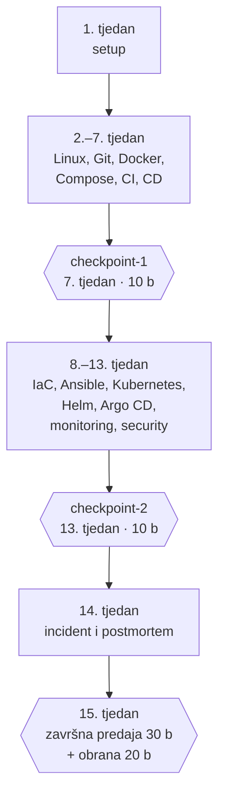
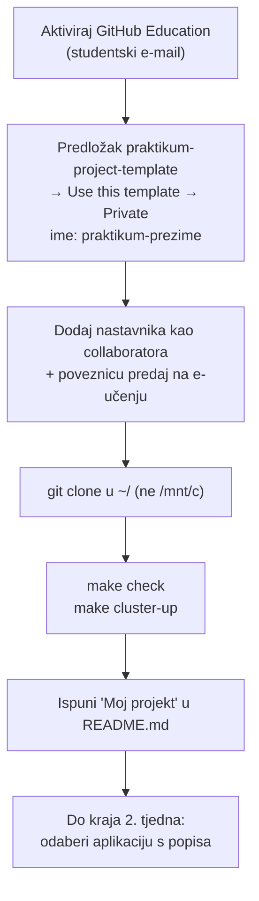
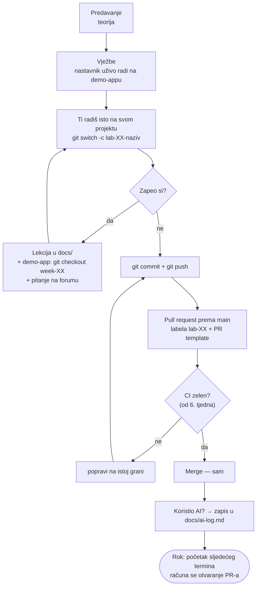
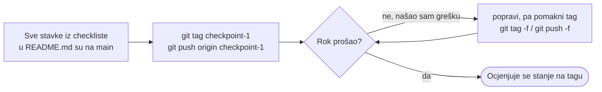
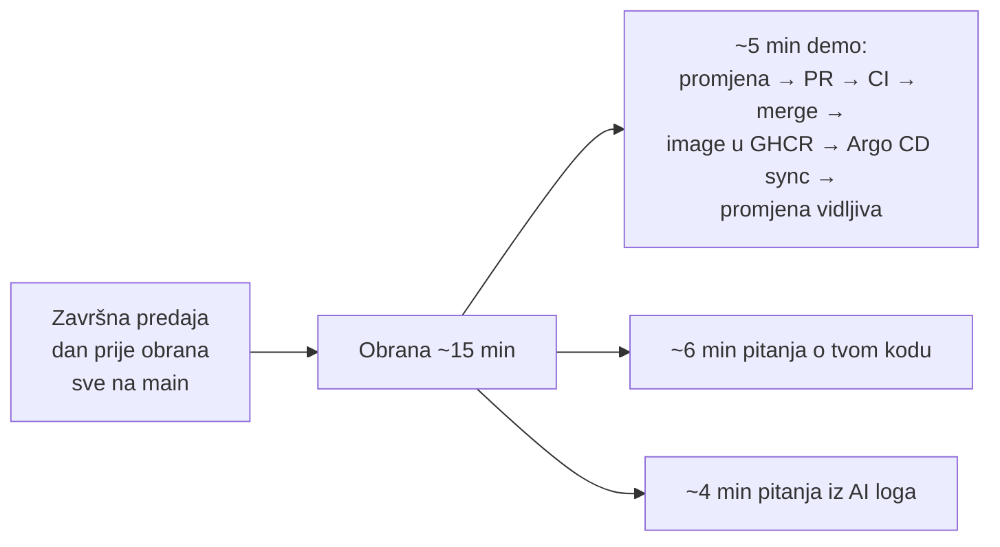

# Hodogram — kako teče semestar

Cijeli kolegij na jednoj stranici: dva repozitorija, jedan postupak koji se ponavlja svaki tjedan i tri točke u kojima se ocjenjuje stanje projekta.

| Repozitorij | Čiji je | Čemu služi |
| --- | --- | --- |
| `praktikum-demo-app` | nastavnikov | ogledna aplikacija s vježbi; stanje nakon svakog tjedna je tag `week-XX`. **Samo gledaš.** |
| `praktikum-<prezime>` | tvoj, iz predloška `praktikum-project-template` | tvoj projekt za cijeli semestar. **Ovdje radiš i predaješ.** |

## Ukratko

Na početku semestra napraviš svoj repozitorij iz predloška i odabereš jednu jednostavnu aplikaciju: API, bazu i Redis. Ta aplikacija je samo povod. Ono što se ocjenjuje je sve što tijekom semestra izgradiš oko nje.

Svaki tjedan ima isti ritam. Na predavanju čuješ teoriju, a na vježbama nastavnik istu stvar uživo napravi na oglednoj aplikaciji, URL shorteneru. Ti zatim to isto napraviš na svom projektu i predaš kao pull request. Tjedan po tjedan tvoj projekt dobiva novi sloj: skripte, Git workflow, Docker, Compose, CI, CD, Terraform, Ansible, Kubernetes, Helm, Argo CD, monitoring i security.

Dva puta tijekom semestra, u 7. i 13. tjednu, staviš tag i time "zamrzneš" stanje projekta za ocjenjivanje. U 14. tjednu simuliramo incident i pišeš postmortem. U 15. tjednu predaješ projekt i braniš ga: pokažeš da promjena u kodu sama stigne do clustera i objasniš što si napravio.

Na kraju imaš aplikaciju koja se sama builda, testira i deploya na Kubernetes, ima monitoring i alert te sigurnosne provjere u pipelineu. Tako se softver isporučuje u industriji.

---

## 1. Semestar u jednoj slici

Semestar ima dvije polovice. **Prva polovica**, do 7. tjedna, vodi aplikaciju od koda na tvom računalu do imagea koji se sam builda i objavi u registry na svaki merge. Na kraju te polovice je **checkpoint 1**.

**Druga polovica**, od 8. do 13. tjedna, vodi isti image na Kubernetes. Cluster se konfigurira iz koda, Argo CD ga sinkronizira iz tvog repozitorija, a uz to dodaješ monitoring i sigurnosne provjere. Na kraju je **checkpoint 2**.

Svaki tjedan nadograđuje prethodni, pa se ništa ne radi "na stranu". Zato je važno ne zaostati, čak i kad lab više ne nosi bodove.

Bodovi:

| Što | Bodovi |
| --- | --- |
| Labovi, 2.–14. tjedan (10 najboljih od 13, po 3 boda) | 30 |
| Checkpoint 1 + checkpoint 2 | 20 |
| Završna predaja | 30 |
| Obrana | 20 |

---

## 2. 1. tjedan — postavljanje (jednom)

Prvi tjedan radiš samo jednom. Cilj mu je da od 2. tjedna imaš okruženje koje radi i repozitorij u koji možeš predavati.

Prijavu za GitHub Education pošalji odmah, jer odobrenje traje nekoliko dana. Dok čekaš, svejedno možeš raditi. Napravi svoj **privatni** repozitorij iz predloška, dodaj nastavnika i poveznicu predaj na e-učenju. Repozitorij kloniraj u Linux home. Na Windowsima to znači unutar WSL-a, a ne na `C:` disk.

`make check` provjerava jesu li instalirani svi alati, a `make cluster-up` diže lokalni Kubernetes cluster. Ako obje naredbe prođu, okruženje je spremno za cijeli semestar.

Do kraja 2. tjedna odaberi aplikaciju s popisa projekata. Vrijedi pravilo "tko prvi prijavi, taj dobije". Odaberi jednostavnu, jer se ne ocjenjuje aplikacija.

Upute: [GitHub Education](github-education.md) · [git šalabahter, poglavlje 1](git-cheatsheet.md#1-jednokratno-postavljanje-1-tjedan) · [kind cluster](../kind/README.md) · [popis projekata](popis-projekata.md)

---

## 3. Svaki tjedan (2.–14.) — isti krug

Ovo je postupak koji ponavljaš trinaest puta i najvažniji je dio hodograma.

**Termin.** Na predavanju čuješ zašto nešto radimo, a na vježbama vidiš kako. Nastavnik isti korak napravi na oglednoj aplikaciji, a ti odmah kreneš na svojoj.

**Rad na grani.** Za svaki lab napraviš novu granu, nikad ne radiš izravno na `main`. Ako zapneš, imaš tri mjesta za pomoć, ovim redom:
1. lekcija tog tjedna u `docs/`,
2. točno stanje ogledne aplikacije nakon tog tjedna (`git checkout week-XX` u demo-appu),
3. forum kolegija, uz cijelu poruku greške i opis onoga što si već probao.

**Predaja.** Kad radi, otvoriš pull request prema `main`, dodaš labelu `lab-XX` i ispuniš PR template. Od 6. tjedna PR automatski provjerava CI. Ako je crven, popravljaš na istoj grani i PR se sam ažurira. Kad je zelen, mergeaš sam, ne čekaš nastavnika.

**AI log.** Ako je AI napisao ili bitno promijenio nešto što predaješ, to zapišeš u `docs/ai-log.md`. Nedeklarirani AI kod tretira se kao tuđe rješenje.

**Rok** je početak sljedećeg termina, a računa se trenutak otvaranja PR-a, ne mergea. Zakašnjeli lab ne nosi bodove, ali ga svejedno napravi, jer sljedeći tjedan gradi na njemu. Zato se broji 10 najboljih od 13: tri propuštena laba ne ruše ocjenu.

Naredbe: [git šalabahter, poglavlje 3](git-cheatsheet.md#3-predaja-laba-svaki-tjedan)

---

## 4. Checkpoint (7. i 13. tjedan)

Checkpoint je **snimka tvog projekta** u jednom trenutku. Ne predaje se ništa posebno. Kad su sve stavke iz checkliste u `README.md` na `main` grani, staviš git tag i pushaš ga.

Ako nakon toga nađeš grešku, popraviš je i pomakneš tag, ali samo **prije roka**. Nakon roka tag se ne pomiče i ocjenjuje se ono što je na njemu. Checkpoint 1 provjerava prvu polovicu semestra (Docker, Compose, CI, GHCR, branch protection), a checkpoint 2 drugu (Ansible, Kubernetes, Helm, Argo CD, monitoring, security).

---

## 5. Završetak (15. tjedan)

Dan prije obrana na `main` grani mora biti sve iz checkliste. Uz to idu `README.md` po kojem netko drugi može pokrenuti projekt od nule, postmortem iz 14. tjedna i AI log vođen kroz semestar.

Obrana traje oko 15 minuta i ima tri dijela:
- **Demo:** napraviš malu promjenu u kodu i pokažeš kako ona sama prođe cijeli put do aplikacije na clusteru. Ako nešto pukne, to je prilika da pokažeš troubleshooting, a ne kazna.
- **Pitanja o tvom kodu:** nastavnik otvori datoteku i pita što radi neki red i zašto je tu.
- **Pitanja iz AI loga:** što je AI predložio, što si promijenio i kako si provjerio.

**Što ne znaš objasniti, ne nosi bodove**, bez obzira na to radi li.

---

## Za prolaz

- najmanje 15 od 30 bodova iz labova
- najmanje 25 od 50 bodova iz projekta, uz obranu
- ukupno najmanje 50 od 100

Prisutnost nije obavezna i ne utječe na prolaz. Ipak dođi kad možeš: na vježbama se uživo radi upravo ono što taj tjedan predaješ.

Sve detaljno: [`ocekivanja.md`](ocekivanja.md) · tjedan po tjedan: [`plan-vjezbi.md`](plan-vjezbi.md)
